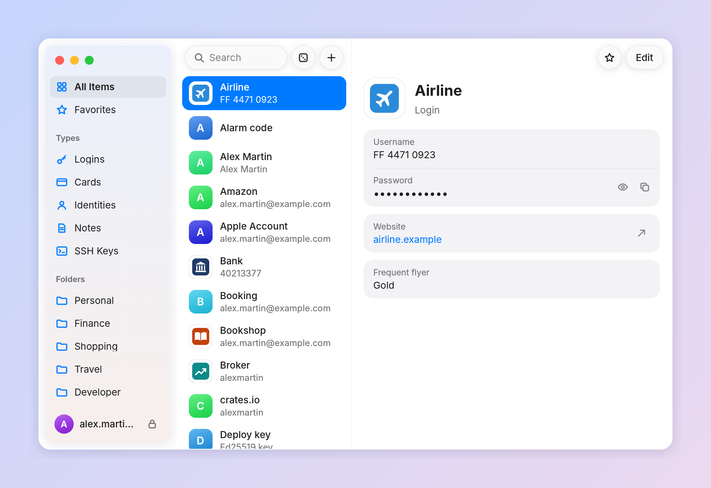
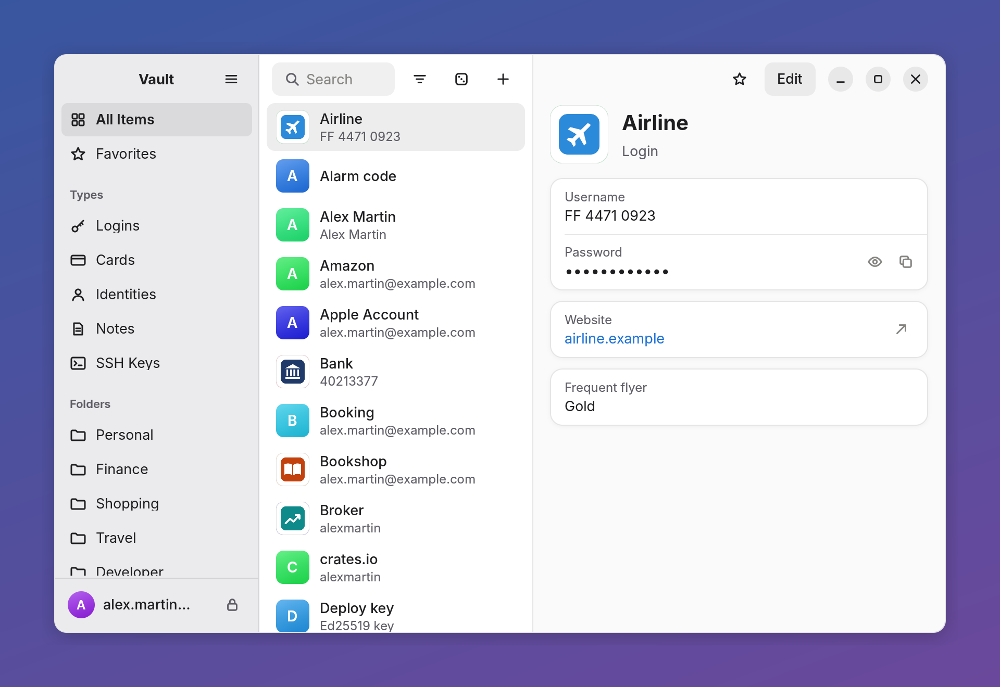

# Fastwarden

A fast desktop app for Bitwarden and Vaultwarden vaults, on macOS and Linux.
Find a password, copy it and save a new one in a window that opens at once.
It is unofficial: Bitwarden, Inc. doesn't make it. Fastwarden is the app of
the rbw-desktop project, which is why its files and packages are named
`rbw-desktop`.





* Several accounts side by side, on bitwarden.com, bitwarden.eu or your own
  server.
* Logins, cards, identities, notes and SSH keys: search, copy, create, edit.
  Verification codes count down as you look.
* A generator for passwords, passphrases and PINs.
* A menu bar item, or a tray item on Linux desktops that show one, with the
  items you used last and the generator.
* A copied password is cleared from the clipboard after a while, and when
  the vault locks.
* Unlock with Touch ID on a Mac that has it.
* rbw's SSH agent, set up from Settings, serves the SSH keys in your vault.

## Install

Download the file for your system from the
[releases](https://github.com/TimotheFCN/rbw-desktop/releases).

**macOS** 12 or later: open `rbw-desktop-VERSION-macos-universal.dmg` and
drag Fastwarden to Applications. If macOS says it can't check the app,
that release isn't notarized: open System Settings, Privacy & Security, and
choose Open Anyway next to Fastwarden.

**Ubuntu, Debian** and their derivatives (Ubuntu 24.04, Debian 13 or later):

```sh
sudo apt install ./rbw-desktop_VERSION_amd64.deb
```

**Other Linux systems**, such as Fedora or Arch: the tarball is laid out
like `/usr`, so it unpacks into `~/.local`:

```sh
tar -xJf rbw-desktop-VERSION-x86_64-linux.tar.xz -C ~/.local --strip-components=1
```

The app shows in your applications once `~/.local/bin` is on your `PATH`,
which most systems set up at login when the folder exists. To remove it,
delete what the tarball lists from `~/.local`.

Packages for arm64 Linux are there too. There's no Windows version, as
rbw-ng runs only on Unix.

## First run

Choose your server (bitwarden.com, bitwarden.eu or the address of your
own), then enter your email, your master password and, if your account has
two-step login, the code. Add more accounts from the account button at the
bottom of the sidebar.

## rbw-ng

The app keeps your vault with [rbw-ng](https://github.com/TimotheFCN/rbw-ng),
a command line Bitwarden client, and comes with its own copy. `rbw-agent`
holds the vault's key while it is unlocked, so the app itself never sees
it, and locks it after the timeout you choose.

Each account is an rbw profile. The app always runs its own copy of rbw-ng:
an `rbw` of another version would restart its agent, which locks the
vault.

## SSH agent

Settings, SSH Agent, sets up rbw's agent as a login service: it serves the
SSH keys stored in your vault to `ssh`, and asks for your master password
when the vault is locked. On macOS the page shows the line to add to
`~/.ssh/config`; on Linux the login session points `SSH_AUTH_SOCK` at it.
On a Mac, set it up again if you move the app, since the service runs the
agent inside it.

## Privacy

* The app, through rbw, talks only to your Bitwarden or Vaultwarden
  server: to sign in, to sync (rbw-agent does every hour, and when you
  choose Sync Now), and to save what you change.
* Website icons: for a login with a website, the app asks your server's
  icon service for that website's icon, which sends the website's name to
  your server, and the server fetches the icon from the website. Icons are
  kept on your computer for 30 days. Settings, General, turns this off.
* Nothing else: no analytics, no crash reports, no update checks. A
  website opens in your browser only when you open it.
* On your computer, rbw keeps the vault encrypted. The app keeps its
  preferences, the ids of the items you used last and the icons in its own
  folders (`~/.config/rbwdesktop` and `~/.cache/rbwdesktop` on Linux,
  `~/Library/Application Support/io.github.timothefcn.RbwDesktop` and
  `~/Library/Caches/io.github.timothefcn.RbwDesktop` on macOS). Signing out
  of an account removes it from this computer.

## Building from source

With the current stable Rust, and on Linux the libraries
[docs/DEVELOPMENT.md](docs/DEVELOPMENT.md) lists:

```sh
cargo build --release -p rbw-desktop
target/release/rbw-desktop
```

Built this way it has no `rbw` of its own, so it runs the `rbw` of rbw-ng
1.19.0 or later on your `PATH`, or the one in `RBW_DESKTOP_RBW`. `RBW_DESKTOP_DEMO=` runs it on demo vaults instead.
[docs/DEVELOPMENT.md](docs/DEVELOPMENT.md) covers the code, the tests and
how the packages are made; [docs/PRODUCT.md](docs/PRODUCT.md) what the app
is for.

MIT License.
