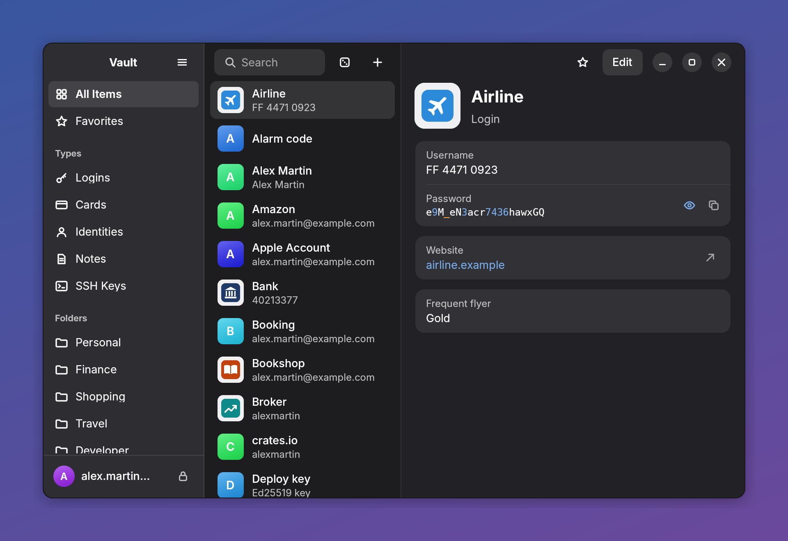
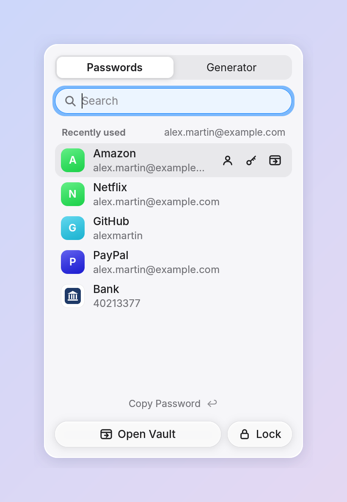

# Fastwarden

A fast desktop client for [Bitwarden](https://bitwarden.com) and
[Vaultwarden](https://github.com/dani-garcia/vaultwarden), for macOS and
Linux.

Fastwarden is written in Rust and draws its interface on the GPU with
[GPUI](https://www.gpui.rs), the framework behind the Zed editor. There is
no browser engine inside. It starts in a third of a second, uses half the
memory of Bitwarden's own desktop app and is a ninth of the download.

<picture>
  <source media="(prefers-color-scheme: dark)" srcset="docs/screenshots/macos-vault-dark.png">
  
</picture>

| | Fastwarden 0.0.1 | Bitwarden 2026.11.0 |
| --- | --- | --- |
| Download, macOS | 28 MB | 310 MB |
| Download, Linux | 14 MB | 130 MB |
| Installed, Linux | 57 MB | 454 MB |
| Memory at the sign-in screen | 180 MB | 355 MB |
| Launch until the window is drawn | 0.3 s | 0.7 s |

Memory and launch measured from each app's `.deb` on the same Linux
machine, without a GPU.
[docs/DEVELOPMENT.md](docs/DEVELOPMENT.md#size-and-start-up) says how.

Fastwarden is unofficial. Bitwarden, Inc. doesn't make it or endorse it.

## What it does

* Several accounts side by side, on bitwarden.com, bitwarden.eu or your own
  server.
* Logins, cards, identities, notes and SSH keys. Search, sort, copy, create,
  edit and delete them. Verification codes count down as you look.
* A generator for passwords, passphrases and PINs.
* A menu bar item with the items you used last and the generator. On Linux
  it is a tray item, on desktops that show one.
* Touch ID unlock on a Mac that has it.
* A copied password leaves the clipboard after a while, and when the vault
  locks.
* An SSH agent for the SSH keys in your vault, and the `rbw` command line.
  Both are off until you turn them on.
* The look of the system it runs on, in light and dark. It follows macOS
  conventions on a Mac and GNOME's on Linux.

<p>
  
  
</p>

It doesn't do attachments, Sends, passkeys or organization administration
yet, and it doesn't fill in forms in your browser. Keep the Bitwarden
browser extension for that. There is no Windows version.

## Install

### macOS

macOS 12 or later, on Apple Silicon or Intel. With
[Homebrew](https://brew.sh):

```sh
brew install --cask timothefcn/tap/fastwarden
```

Or download
[rbw-desktop-macos-universal.dmg](https://github.com/TimotheFCN/rbw-desktop/releases/latest/download/rbw-desktop-macos-universal.dmg),
open it and drag Fastwarden to Applications.

**macOS blocks the first launch, and that is expected for now.** Apple
hasn't notarized Fastwarden yet, so the first time you open it macOS says it
could not verify the app. Choose Done, then open System Settings, Privacy &
Security, scroll down to Security and choose Open Anyway next to Fastwarden.
You do this once.

### Linux

On Ubuntu 24.04, Debian 13 and later, download the `.deb` for
[x86_64](https://github.com/TimotheFCN/rbw-desktop/releases/latest/download/rbw-desktop_amd64.deb)
or
[arm64](https://github.com/TimotheFCN/rbw-desktop/releases/latest/download/rbw-desktop_arm64.deb)
and install it:

```sh
sudo apt install ./rbw-desktop_amd64.deb
```

On other distributions with glibc 2.39 or later, such as Fedora or Arch,
download the tarball for
[x86_64](https://github.com/TimotheFCN/rbw-desktop/releases/latest/download/rbw-desktop-x86_64-linux.tar.xz)
or
[arm64](https://github.com/TimotheFCN/rbw-desktop/releases/latest/download/rbw-desktop-aarch64-linux.tar.xz).
It is laid out like `/usr`, so it unpacks into `~/.local`:

```sh
tar -xJf rbw-desktop-x86_64-linux.tar.xz -C ~/.local --strip-components=1
```

Fastwarden shows up in your applications once `~/.local/bin` is on your
`PATH`, which most systems set up at login when the folder exists. To remove
it, delete the files the tarball lists.

Every file, with its checksum, is on the
[releases page](https://github.com/TimotheFCN/rbw-desktop/releases).

## Getting started

1. Open Fastwarden and choose your server: bitwarden.com, bitwarden.eu or
   the address of your own.
2. Enter your email and master password, then the two-step code if your
   account has one. bitwarden.com can also ask for your account's
   [personal API key](https://bitwarden.com/help/personal-api-key/) the
   first time, because it treats clients it doesn't know as bots.
3. Your vault opens. Add more accounts from the account button at the
   bottom of the sidebar.

Settings holds the lock timeout, Touch ID, the SSH agent and the command
line tool.

## Built on rbw-ng

Fastwarden is a window onto
[rbw-ng](https://github.com/TimotheFCN/rbw-ng), a command line Bitwarden
client, and comes with its own copy. You don't install anything else.
rbw-ng's agent holds the vault's key while the vault is unlocked and locks
it after the timeout you choose. The app never sees the key, and it asks
the agent for a password only to show or copy it.

Two more things come with it. Turn them on in Settings if you want them.

* **The command line.** General, Command line tool, puts the app's `rbw` on
  your `PATH`, at `/usr/local/bin/rbw` on macOS and `~/.local/bin/rbw` on
  Linux. `rbw get github` in a terminal then uses the same accounts and the
  same unlocked vault as the app.
* **An SSH agent.** SSH Agent sets up rbw-ng's agent as a login service that
  serves the SSH keys in your vault to `ssh` and `git`. On macOS the page
  shows the line to add to `~/.ssh/config`. On Linux your session's
  `SSH_AUTH_SOCK` points to it.

Don't install rbw-ng separately next to the app. Two different versions
lock each other's vault, and Fastwarden tells you when it finds another
`rbw`. If you move the app, turn both on again, since they point inside it.

## Privacy

* Fastwarden talks only to your Bitwarden or Vaultwarden server, to sign
  in, to sync and to save what you change. The agent syncs every hour and
  when you choose Sync Now.
* For a login with a website, the app asks your server's icon service for
  the website's icon. That sends the website's name to your server, which
  fetches the icon. Icons stay on your computer for 30 days. Settings,
  General, turns this off.
* There are no analytics, no crash reports and no update checks.
* rbw-ng keeps the vault encrypted on your computer. The app keeps its
  preferences, the ids of the items you used last and the icons in its own
  folders: `~/.config/rbwdesktop` and `~/.cache/rbwdesktop` on Linux,
  `io.github.timothefcn.RbwDesktop` under `~/Library/Application Support`
  and `~/Library/Caches` on macOS. Signing out of an account removes it
  from the computer.

To report a vulnerability, see [SECURITY.md](SECURITY.md).

## Contributing

Fastwarden is young, and reports from real vaults and real desktops are
what it needs most. If something breaks or looks wrong,
[open an issue](https://github.com/TimotheFCN/rbw-desktop/issues/new/choose)
with your system and whether your server is Bitwarden's or Vaultwarden.
Ideas and pull requests are welcome. For anything larger than a fix, open
an issue first so we agree on the shape before you write it.

To run it from source you need a current stable Rust and, on Linux, the
libraries [docs/DEVELOPMENT.md](docs/DEVELOPMENT.md#build-and-run) lists:

```sh
git clone https://github.com/TimotheFCN/rbw-desktop
cd rbw-desktop
RBW_DESKTOP_DEMO= cargo run -p rbw-desktop   # demo vaults, no account needed
```

Without `RBW_DESKTOP_DEMO` a source build runs the `rbw` on your `PATH`,
which has to be rbw-ng 1.19.0 or later. [CONTRIBUTING.md](CONTRIBUTING.md)
covers the checks to run and how to send a change,
[docs/DEVELOPMENT.md](docs/DEVELOPMENT.md) the code, the tests and the
packages, and [docs/PRODUCT.md](docs/PRODUCT.md) what the app is for and
what it leaves out.

## License

MIT. See [LICENSE](LICENSE).
